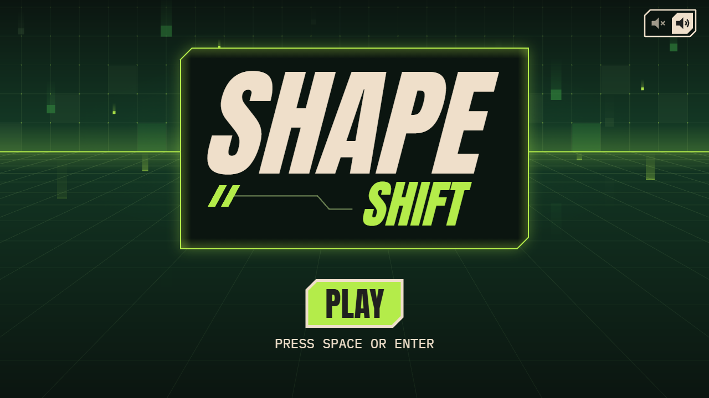
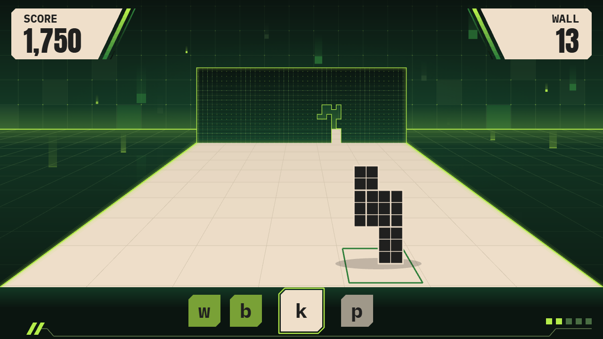
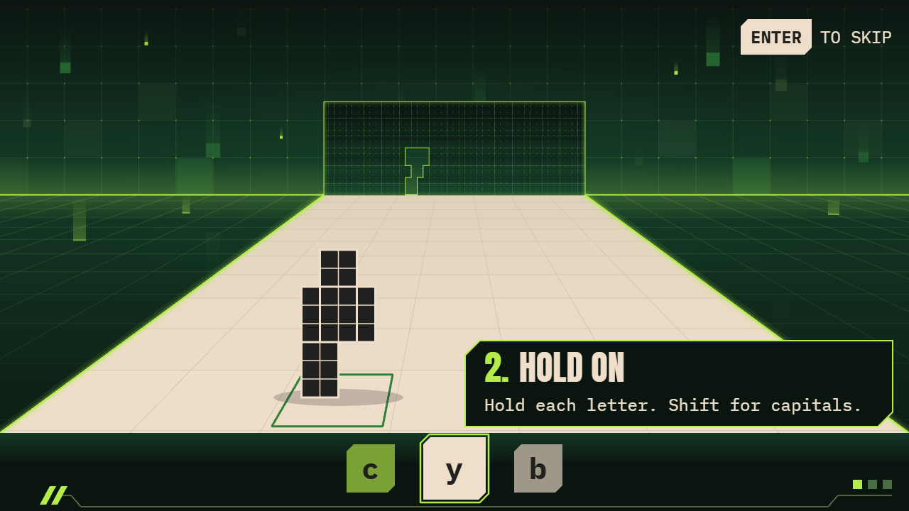
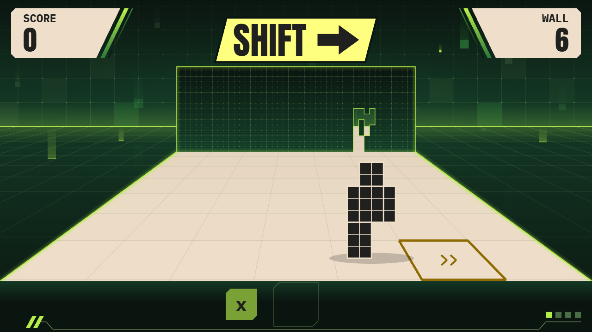
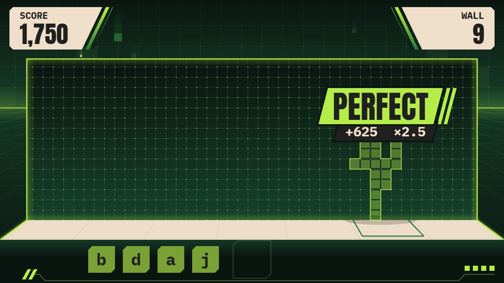

# SHAPE SHIFT

A keyboard take on Japan's "Human Tetris", made for GitHub Game Off 2026
(theme: SHIFT). A wall with a hole in it comes toward you. Line up under the
hole, then hold down the letters shown to pose your figure so it fits
through. Let go too soon, press the wrong key or run out of time, and the
wall knocks you over.



The theme runs through it three ways: the **Shift key** (capital letters
need it), **shape-shifting** (your figure changes pose for every wall), and
**shifting walls** (on Shift Walls the hole slides while the wall is on its
way).

**Status:** in development for the jam. A full run plays from the title
through the tutorial, an endless run of walls that get harder, and the game
over screen. Next is the itch.io release (M12 in [PLAN.md](./PLAN.md)).

## How to play

1. **Line up.** Tap **Space** to step one lane toward the hole. Letters only
   appear once you're lined up under it.
2. **Hold on.** Letters show one at a time in the bar along the bottom.
   Press each one and keep it held: every held letter moves a part of your
   figure into the hole's shape. Capitals need **Shift** down as you press
   them (their key cap carries a ⇧ mark), and lowercase letters need Shift
   up.
3. **Fit through.** Lined up with every letter held, your pose locks and the
   wall passes around you. The next wall is already coming.



Watch out for:

- **Slips.** Let go of a held letter and that part of your figure goes limp.
  The letter goes to the back of the line, and you press it again when it
  comes back round.
- **Wrong keys.** Any letter that isn't the one in the bar's center pushes
  the wall closer. So does the right letter with Shift the wrong way: a
  capital without it, or a lowercase letter with it.
- **Losing focus.** Click away from the game and it pauses. Every held
  letter counts as let go, so you hold them again when you come back.

### Controls

| Key | What it does |
|---|---|
| **Space** | Step one lane toward the hole; press a screen's button |
| **Letters** | Hold the letter in the bar's center |
| **Shift** | Hold it as you press a capital letter |
| **Enter** | Skip the tutorial; press a screen's button |
| **Arrow keys** | On the title, move between Play and the sound switch |

The game is played entirely on the keyboard, so you'll need a physical one.

### The tutorial

When you press Play on the title, an interactive tutorial walks you through
one real wall, one step at a time: line up, hold every letter, then see how you
scored. The wall waits until you hold your first letter. Then READY? 3, 2, 1
and your run begins. Press **Enter** to skip it.



### Shift Walls

From wall 4, some walls shift. The wall stops behind a **SHIFT** callout,
its hole slides one lane, and the new lane is marked on the floor. Tap Space
to line up again **while keeping your letters held**: new letters wait until
you're back under the hole.



### Scoring

The sooner you lock your pose, the more a wall is worth:

| Result | When | Points |
|---|---|---|
| **PERFECT** | in the first half of the wall's approach | 100 + 150 |
| **GREAT** | by three quarters of the way | 100 + 75 |
| **CLOSE CALL** | any later | 100 + 25 |

PERFECTs in a row build a streak multiplier, ×1.5 for the second, ×2 for the
third, up to ×3. Any other result resets it.



### Getting harder

Each stretch of walls adds one new demand: Shift Walls from wall 4, four
letters from wall 6, letters spread further across the keyboard from wall 8,
a capital from wall 10, five letters from wall 13 and up to two capitals
from wall 16. From wall 19, two letters can fall to the same finger. The
first walls take 10 s to reach you; they speed up as you go, and from wall
19 each is 4% faster than the last, down to 3.5 s.

### Sound and comfort

- Synthesized sound effects, tuned to the key of the music. The sound switch
  in the title's top-right corner mutes everything.
- Motion effects (screen shakes, the jolt as a hole shifts, the buttons'
  pulse) are skipped if your system asks for reduced motion.
- Text meets WCAG AAA contrast, and a warning shows while Caps Lock is on.

## Built with

[Phaser 4](https://phaser.io), TypeScript, Vite and Vitest. Everything on
screen is drawn in code, and the sound effects are synthesized with the Web
Audio API. The fonts are Anton and IBM Plex Mono (SIL Open Font License),
bundled from `@fontsource`.

See [PLAN.md](./PLAN.md) for the full design and milestones, and
[AGENTS.md](./AGENTS.md) for the working rules.

## Setup

Requires Node `^22.12`, `^24` or `>=26`.

```
npm install
```

## Commands

| Command | What it does |
|---|---|
| `npm run dev` | Dev server at http://localhost:5173 |
| `npm test` | Unit tests (Vitest), run once |
| `npm run test:watch` | Unit tests in watch mode |
| `npm run check` | Type check |
| `npm run build` | Type check, then production build to `dist/` |
| `npm run preview` | Serve the built `dist/` locally |

During play, **F2** toggles a debug overlay with the wall's state, timing,
lanes, letters and stretch score. Tuning values live in `src/config.ts`.

On the dev server, URL options skip ahead for playtesting (published builds
ignore them):

| URL | What it does |
|---|---|
| http://localhost:5173/?wall=13 | Every run, restarts included, starts at wall 13 |
| http://localhost:5173/?shiftwall | Every wall is a Shift Wall |
| http://localhost:5173/?wall=12&shiftwall | Both |

## Deploy (itch.io)

1. `npm run build`
2. Zip the **contents** of `dist/`, so `index.html` sits at the root of the zip.
3. On itch.io, upload the zip as an HTML5 game and set the embed size to
   1280×720.

The build uses relative paths, so it runs from whatever folder itch.io serves
it from. It does need to be served over HTTP: opening `dist/index.html`
straight from disk won't work, because browsers block module scripts on
`file://`. Use `npm run preview` to try the build locally.
